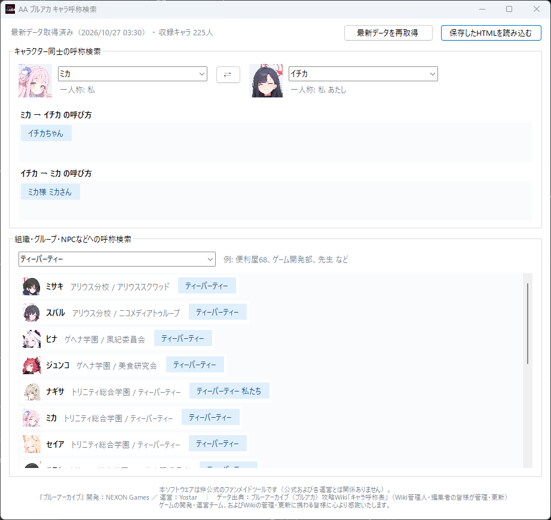

# AA ブルアカ キャラ呼称検索

『ブルーアーカイブ』二次創作支援ツール。キャラクター同士の相互の呼び方（一／二人称）と、組織・グループ・NPCなどへの全キャラクターからの呼称を素早く検索出来ます。

二次創作小説を書いていて、新キャラ登場の度に呼称を調べるのが面倒になってしまったので作りました。

> ⚠️ 本ツールは非公式のファンメイドツールです。『ブルーアーカイブ』開発: NEXON Games / 運営: Yostar。データ出典: ブルーアーカイブ攻略Wiki「キャラ呼称表」。

## 機能

- インストール不要、配布zipファイルを解凍するだけでポータブル動作（exeファイル単独で動作）
- 起動時に最新データを自動取得、オフライン時はキャッシュで動作
- ドロップダウンはひらがな／カタカナ・大文字／小文字を区別しない絞り込み
- 顔アイコン表示（取得状況をツールチップ表示）

## 動作環境

- Windows 10 / 11
- .NET Framework 4.x（OS 標準搭載）
- 初回起動時のみインターネット接続が必要

## 手元でビルド場合の方法

1. `AA_BlueArchiveKoshoSearch.cs`、`BuildExe.bat`、`app.ico` を同じフォルダに置く
2. `BuildExe.bat`をダブルクリック
3. `AA_BlueArchiveKoshoSearch.exe`が生成される

（`app.ico`が無くてもビルド可能）

## 使い方

- 上段: キャラクター 2 人を選択 → 相互の呼称と一人称を一覧表示。⇄ で入れ替え
- 下段: 組織・グループ・NPC などを選択 → その相手への全キャラクターからの呼称を一覧表示
- 注釈（`*1` 等）はマウスオーバーで内容表示

## 動作時に生成されるファイル（exeファイル本体と同じフォルダ）

- `kosho_cache.html` — 取得したキャラ呼称表データ
- `kosho_settings.txt` — 前回選択したキャラ・組織
- `kosho_icons\` — 顔アイコンの画像キャッシュ

アンインストールはexeファイルと上記ファイルを削除するだけです（レジストリ不使用）。

## スクリーンショット

## ライセンス

MIT License — 詳細は [LICENSE](LICENSE) を参照。

## クレジット

- 『ブルーアーカイブ』開発: NEXON Games / 運営: Yostar
- データ出典: ブルーアーカイブ攻略Wiki「キャラ呼称表」(https://bluearchive.wikiru.jp/?キャラ呼称表)
- 本ツールは非公式のファンメイドツールであり、公式および Wiki 運営とは無関係です。
- 本ツールの開発過程で生成AIを利用しています。